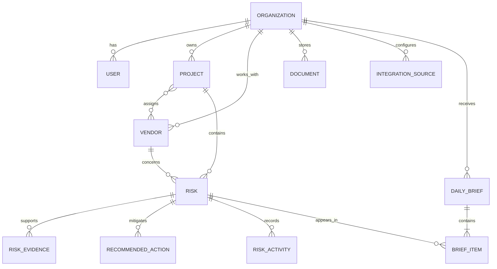

# Sightline V1 data model

Sightline V1 stores the evidence and human decisions behind a deterministic
weekly profit-risk brief. It does not generate risks or brief language with AI.

## Model overview



The source of truth is the SQL migrations in `supabase/migrations/`. The
portfolio experience adds projected project margin and risk ownership in
`20260719010000_project_margin_and_risk_owner.sql`.

## Entity notes

- `organizations` is the tenant boundary for every V1 record.
- `users` represents an application profile. `auth_user_id` is nullable until
  authentication is connected; one V1 user belongs to one organization.
- `projects` stores basic portfolio and contract context. Contract value and
  projected margin are stored in integer cents.
- `vendors` can be assigned to many projects through `project_vendors`.
- `integration_sources` records provenance without implementing an integration.
  The seed uses a deterministic `manual` source.
- `documents` can optionally reference a project, vendor, and integration
  source. File storage is deliberately separate from document metadata.
- `risks` carries the executive-facing risk assessment and may be assigned to
  an organization user. Exposure and margin impact are non-negative integer
  cents; confidence is an integer percentage from 0 through 100.
- `risk_evidence` preserves the observable basis for a risk and may reference a
  source document.
- `recommended_actions` captures human-owned mitigation work.
- `risk_activities` is an append-oriented audit timeline for status changes and
  human actions. Arbitrary structured context belongs in `metadata`.
- `daily_briefs` are assembled as drafts. A deferred database constraint
  requires exactly three distinct, prioritized items when a brief is published.
- `brief_items` reference risks and preserve the deterministic explanation and
  recommended next step shown on that date.

## Daily brief selection

`selectDailyBriefRisks` excludes `resolved` and `dismissed` risks, then sorts
deterministically by:

1. Severity (`critical`, `high`, `medium`, `low`)
2. Estimated margin impact in cents
3. Potential exposure in cents
4. Confidence score
5. Most recent detection time
6. Risk ID for a stable final tie-break

It returns up to three risks. A brief can only be published with three distinct
risk references. If fewer than three eligible risks exist, the application may
retain a draft or choose not to create a brief.

## Tenant integrity and security

Composite foreign keys ensure related project, vendor, document, user, risk,
and brief records belong to the same organization. Row-level security is
enabled on every application table. V1 grants database access only to the
Supabase `service_role`; no anonymous or authenticated-user policies are
defined yet. Repository functions must therefore execute in server-only code
through `createAdminSupabaseClient`.

The service-role key must never use the `NEXT_PUBLIC_` prefix or be imported by
a Client Component.

## Index strategy

Indexes cover the expected V1 access paths:

- Organization-scoped user, project, vendor, document, source, brief, and
  activity lists
- Project/status and vendor/status risk queues
- Active risk due dates, detection dates, severity, exposure, and confidence
- Project completion dates and document dates
- Evidence, action, brief-item, and activity lookups by parent record

Partial indexes keep active due-date and priority queues small by excluding
resolved or dismissed work.

## Local workflow

Docker must be running.

```bash
npm run db:start
npm run db:reset
npm run db:types
```

`db:reset` reapplies all migrations and then `supabase/seed.sql`. Supabase Studio
is available at `http://127.0.0.1:54323` with the default local configuration.

## Seed contents

The deterministic seed creates BuildCo Construction with one executive user,
four projects, five vendors, eight risks, and one published three-item brief.
The featured risks are:

- Expiring Apex Electrical subcontractor insurance
- A weather-related Riverfront concrete delay
- Daily logs indicating a possible Northgate owner-directed scope dispute

Each featured risk includes evidence and a recommended action. No model output,
external API, or current weather feed is required.

## Major assumptions

- V1 users have one organization membership. A membership join table can be
  introduced later if cross-organization access is required.
- All money shares the organization's operating currency; V1 does not perform
  currency conversion.
- PostgreSQL `bigint` protects cent values at the database layer. Application
  validation limits values to JavaScript's safe-integer range.
- Brief content is a historical snapshot and does not change when the source
  risk is later edited.
- Risk deletion cascades evidence, actions, and activity but is restricted when
  a historical brief item references the risk.
- Authenticated-user RLS policies are deferred until the authentication model is
  implemented.
- V1 server queries and mutations use the seeded BuildCo organization as their
  explicit tenant boundary. Replacing that constant with the authenticated
  user's organization context is required when authentication is introduced.
