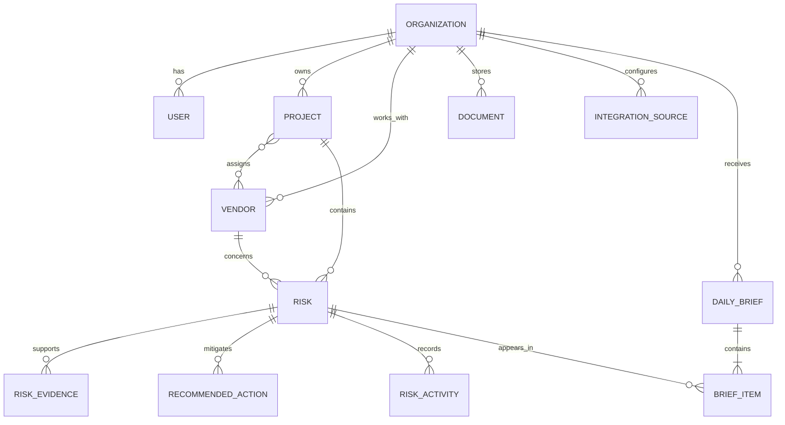

# Sightline V1 data model

Sightline V1 stores the evidence and human decisions behind a deterministic
weekly profit-risk brief. Its optional AI layer produces evidence-grounded
suggestions only; suggestions require human approval before becoming risks.

## Model overview



The source of truth is the SQL migrations in `supabase/migrations/`. The
portfolio experience adds projected project margin and risk ownership in
`20260719010000_project_margin_and_risk_owner.sql`.

## Entity notes

- `organizations` is the tenant boundary for every V1 record.
- `users` represents an application profile. `auth_user_id` is nullable until
  authentication is connected; one V1 user belongs to one organization.
- `projects` stores basic portfolio and contract context. Contract value and
  projected margin are stored in integer cents.
- `vendors` can be assigned to many projects through `project_vendors`.
- `integration_sources` records provenance without implementing an integration.
  The seed uses a deterministic `manual` source.
- `documents` can optionally reference a project, vendor, and integration
  source. File storage is deliberately separate from document metadata. The
  document workflow adds original filename, verified MIME type, byte size,
  processing status, and archival timestamp fields.
- `document_activities` records manual upload, metadata edit, and archive
  events without exposing storage credentials or file URLs.
- `risks` carries the executive-facing risk assessment and may be assigned to
  an organization user. Exposure and margin impact are non-negative integer
  cents; confidence is an integer percentage from 0 through 100.
- `risk_evidence` preserves the observable basis for a risk and may reference a
  source document. It records a typed source, excerpt, human-readable source
  label and location, optional page and line range, source date, relevance
  score, and whether the item is direct evidence, an inference, or an
  assumption.
- `recommended_actions` captures human-owned mitigation work.
- V2 adds action priority and `risk_resolutions`, an append-only record of the
  reviewer, resolution type, summary, and optional realized impact in cents.
- `risk_activities` is an append-oriented audit timeline for status changes and
  human actions. Arbitrary structured context belongs in `metadata`.
- `daily_briefs` are assembled as drafts. A deferred database constraint
  requires exactly three distinct, prioritized items when a brief is published.
- `brief_items` reference risks and preserve the deterministic explanation and
  recommended next step shown on that date.
- `document_extracted_fields` stores the small structured field set consumed by
  V1 rules. Values are seeded or manually supplied; no OCR or model runs.
- `project_detection_settings` holds deterministic rule thresholds such as the
  maximum concrete-placement temperature.
- `detection_runs` records the trigger source, per-rule findings, created and
  updated counts, completion state, and failures for every engine run.
- `ai_analysis_runs` records metadata-only input/output snapshots, provider,
  model, prompt version, latency, token usage, and failure/fallback state.
- `ai_risk_suggestions` is the review queue. Only approved suggestions reference
  an activated risk; rejected suggestions retain the review reason. Sanitized
  review context is retained only while a suggestion is pending.
- `ai_observability_events` centralizes privacy-safe usage, latency, retrieval,
  evidence, and status telemetry without storing prompts or customer content.
- `risk_email_drafts` stores human-editable risk communications and their
  generation provenance. Drafts may reference a recommended action and a known
  organization user or vendor contact. `manually_sent` records only a human
  attestation; Sightline does not deliver the message.

## Deterministic detection

Each generated risk has an organization-scoped `detection_key`. Evidence and
recommended actions have corresponding keys scoped to their parent risk. These
database constraints make repeated runs update records instead of duplicating
them. Reruns preserve human-closed risk statuses, original detection times, and
completed action statuses.

V1 evaluates three isolated rules: insurance expiration within 14 days for a
vendor active on an open project; a concrete pour within seven days whose
forecast temperature exceeds its project threshold; and the same issue keyword
in three daily logs within seven days when no matching RFI exists. Confidence,
explanations, exposure, and recommended actions are deterministic.

After persistence, the engine applies the existing brief-priority comparator,
replaces today's draft items, and publishes only when exactly three eligible
risks are available.

## Morning email delivery

User profiles store whether morning email is enabled, the preferred local
delivery time, and an IANA timezone. `daily_brief_deliveries` is the durable
delivery ledger. A partial unique index permits only one scheduled delivery per
organization, brief, and user; test sends are recorded separately.

Scheduled rows use a stable provider idempotency key derived from the brief and
user. Failed attempts reuse that key, retry up to three times with increasing
delays, and retain the provider error. A sent row is never submitted again.
Email content is rendered to both responsive, inline-styled HTML and plain text.
Only application deep links are included; provider credentials and delivery
identifiers are never placed in links.

## Daily brief selection

`selectDailyBriefRisks` excludes `resolved` and `dismissed` risks, then sorts
deterministically by:

1. Severity (`critical`, `high`, `medium`, `low`)
2. Estimated margin impact in cents
3. Potential exposure in cents
4. Confidence score
5. Most recent detection time
6. Risk ID for a stable final tie-break

It returns up to three risks. A brief can only be published with three distinct
risk references. If fewer than three eligible risks exist, the application may
retain a draft or choose not to create a brief.

## Tenant integrity and security

Composite foreign keys ensure related project, vendor, document, user, risk,
and brief records belong to the same organization. Row-level security is
enabled on every application table. V1 grants database access only to the
Supabase `service_role`; no anonymous or authenticated-user policies are
defined yet. Repository functions must therefore execute in server-only code
through `createAdminSupabaseClient`.

The service-role key must never use the `NEXT_PUBLIC_` prefix or be imported by
a Client Component.

## Document storage

Source files are stored in the private `source-documents` Supabase Storage
bucket. Object paths begin with the trusted organization ID and a generated
document ID; sanitized filenames are used only as the final path component.
The application checks file signatures instead of trusting browser MIME values.
Downloads re-check the organization-scoped document row and issue a signed URL
that expires after 60 seconds. Archiving preserves the object for audit and
future retention-policy work but disables application downloads.

V1 accepts PDF, DOCX, CSV, JPG, and PNG files up to 10 MB. The processing status
is present for future OCR or extraction work; successful manual uploads are
marked `ready`, and no extraction is performed.

## Index strategy

Indexes cover the expected V1 access paths:

- Organization-scoped user, project, vendor, document, source, brief, and
  activity lists
- Project/status and vendor/status risk queues
- Active risk due dates, detection dates, severity, exposure, and confidence
- Project completion dates and document dates
- Evidence, action, brief-item, and activity lookups by parent record

Partial indexes keep active due-date and priority queues small by excluding
resolved or dismissed work.

## Local workflow

Docker must be running.

```bash
npm run db:start
npm run db:reset
npm run db:types
```

`db:reset` reapplies all migrations and then `supabase/seed.sql`. Supabase Studio
is available at `http://127.0.0.1:54323` with the default local configuration.

## Seed contents

The deterministic seed creates BuildCo Construction with one executive user,
four projects, five vendors, eight risks, and one published three-item brief.
The featured risks are:

- Expiring Apex Electrical subcontractor insurance
- A weather-related Riverfront concrete delay
- Daily logs indicating a possible Northgate owner-directed scope dispute

Each featured risk includes evidence and a recommended action. No model output,
external API, or current weather feed is required.

## V2 recommended action lifecycle

`recommended_actions` are deliberately risk-scoped rather than general project
tasks. An action begins as `suggested`, can be `accepted`, moves to
`in_progress`, and ends as `completed` or `dismissed`. Acceptance and completion
never change the parent risk status; risk resolution remains an explicit,
separate operation. A dismissal stores both its timestamp and required human
reason so later evaluation can distinguish a poor recommendation from work that
became unnecessary.

Each row records an action type, priority, optional organization user owner,
due date, creator, and source (`human`, `deterministic_rule`, or
`ai_suggestion`). Organization/status/due, owner/status, priority/status, and
risk/status indexes support the action register and risk panels. Every mutation
is authorized by organization and appends an `action_updated` risk activity;
the application restores the previous row if that audit append fails.

## V2 risk activity timeline

Risk activity is an append-only user-facing event stream. Rows store an event
type, actor type (`user`, `system`, `ai`, or `integration`), optional actor user,
readable summary, structured JSON metadata, mentioned organization users, and
an occurrence timestamp. Database triggers reject updates and deletes; a
correction must be recorded as a new event. Legacy event types remain unchanged
in storage and are normalized only for presentation.

The organization and risk cursor indexes order events by `occurred_at` and `id`
for stable pagination. Comment mentions are retained in the activity record but
do not trigger external notifications in this version. Operational console logs
and provider diagnostics remain separate from this executive-facing history.

## V2 evidence and trust boundary

Evidence reads begin with an organization-scoped risk lookup and every evidence
and document query repeats the organization predicate. Document links use the
existing authorized download endpoint, which re-checks the tenant and returns a
short-lived signed URL; archived or missing source objects render as unavailable
instead of producing a broken or public link.

The risk evidence view separates direct evidence from inferred conclusions and
assumptions. Excerpts, source labels, dates, page or line locations, relevance,
and confidence factors remain visible to reviewers. The explanation panel is a
concise product rationale assembled from those records; it never displays model
chain-of-thought. Missing citations and unavailable documents are shown
explicitly rather than silently omitted.

AI analysis remains a suggestion boundary. Every material structured output
field must cite supplied evidence IDs, and `validateEvidenceGrounding` rejects
the entire output when any top-level or claim-level citation is absent from the
request context. AI output is not itself direct evidence. It remains an inferred
conclusion until a human reviews it, and activation still requires explicit
approval.

In development only, `/internal/evidence-debug` exposes evidence identifiers,
types, support classification, relevance, citation location, and document
availability for troubleshooting. The route returns a 404 in production.

## Major assumptions

### V2 risk resolution

`risk_resolutions` stores an immutable outcome record for each resolution cycle.
It includes the resolution type and summary, final owner, resolved date,
completed action identifiers, estimated exposure before and after resolution,
estimated loss avoided, warning-usefulness and prediction-accuracy feedback,
and optional internal notes. `initial_prediction` snapshots the original risk
title, classification, confidence, exposure estimates, explanation, dates, and
owner so later edits cannot rewrite what Sightline originally presented.

Reopening does not delete or replace a resolution. The resolution receives a
reopen timestamp and required reason, the risk returns to `action_needed`, and
an append-only `risk_reopened` activity is created. A later resolution creates a
new resolution row. Portfolio value totals include only the latest unreopened
resolution for risks that remain resolved. All financial values are explicitly
treated as user-entered estimates; warning usefulness does not establish that
Sightline caused an avoided loss.

### Risk conversations

`risk_conversations` has one thread per organization, risk, and user.
`risk_conversation_messages` stores user questions and assistant answers,
including answer availability, cited evidence IDs, confidence, missing
information, follow-ups, provider metadata, latency, and token usage.
`risk_answer_feedback` stores one current rating per answer and user. The
application retains the newest 20 messages per conversation; message deletion
for retention is the one intentional exception to the otherwise append-only
risk activity model.

- V1 users have one organization membership. A membership join table can be
  introduced later if cross-organization access is required.
- All money shares the organization's operating currency; V1 does not perform
  currency conversion.
- PostgreSQL `bigint` protects cent values at the database layer. Application
  validation limits values to JavaScript's safe-integer range.
- Brief content is a historical snapshot and does not change when the source
  risk is later edited.
- Risk deletion cascades evidence, actions, and activity but is restricted when
  a historical brief item references the risk.
- Authenticated-user RLS policies are deferred until the authentication model is
  implemented.
- V1 server queries and mutations use the seeded BuildCo organization as their
  explicit tenant boundary. Replacing that constant with the authenticated
  user's organization context is required when authentication is introduced.
- Upload throttling is process-local and intentionally basic. A shared limiter
  should replace it before horizontally scaled production deployment.
