# Sightline V2 architecture

## Objective

V2 extends Sightline from identifying weekly profit risks to helping a customer
investigate, assign, and resolve them. This foundation preserves every V1 route
and keeps unfinished V2 UI disabled.

## V1 audit

### What is working

- Next.js App Router pages default to Server Components and introduce Client
  Components only for interaction.
- PostgreSQL uses organization-scoped composite foreign keys for tenant-owned
  relationships.
- Risks already support owners, due dates, evidence, actions, and activity.
- Deterministic detection is isolated from presentation and remains the fallback
  when AI is unavailable.
- AI risk suggestions are structured, evidence-grounded, and require review.
- Document download links are short-lived and storage objects remain private.

### Debt addressed in this preparation

- Request identity and organization scope were hard-coded at call sites.
- Risk mutations contained persistence and audit logic in Server Actions.
- Audit records were constructed differently by each feature.
- Recommended actions did not have priority.
- Resolution had no durable record of outcome, reviewer, summary, or realized
  impact.
- V2 capabilities had no centralized off switch.
- The code had no explicit contracts for grounded generation or notifications.

### Debt intentionally retained

- `SightlineRepository` is a broad V1 repository and is currently unused. It is
  retained to avoid a risky rewrite, but V2 code should use small application
  services rather than expand it.
- V1 has no real login/session integration. `requireActorContext` verifies the
  seeded Matt/BuildCo record and is the only adapter that should be replaced
  when Supabase Auth is connected.
- Service-role access remains the server data path; authenticated and anonymous
  database roles have no table access. Organization authorization must therefore
  happen before every service-role query.
- Multi-record mutations use compensating rollback. PostgreSQL RPC functions
  should provide true transactions before production V2 mutation volume grows.

## Domain concepts

### Recommended action

A risk-owned work item with an owner, status, due date, and priority (`low`,
`normal`, `high`, or `urgent`). Action writes must also append risk activity.
The lifecycle is `suggested → accepted → in_progress → completed`, with
`dismissed` as a terminal branch requiring a retained reason. Completing work
does not implicitly resolve its risk.

### Risk resolution

An append-only record of who resolved a risk, when, the resolution type, a human
summary, and optional realized financial impact. Multiple records can preserve
future resolve/reopen cycles.

### Evidence citation

An organization-scoped evidence record that can reference a private source
document. AI-generated content may cite only evidence returned by the evidence
service for the same risk and organization.

### Grounded generation

A narrow AI request for either a risk email draft or a contextual risk answer.
It receives an explicit purpose, instruction, risk ID, organization ID, and
bounded evidence. It is not a generic chat or agent interface.

## Service boundaries

| Boundary                    | Responsibility                                                      | Must not do                       |
| --------------------------- | ------------------------------------------------------------------- | --------------------------------- |
| `RiskManagementService`     | Risk status, ownership, due dates, acknowledgement, dismissal       | Render UI or generate AI text     |
| `RecommendedActionService`  | Action reads/creation, ownership validation, priority, action audit | Send notifications directly       |
| `RiskActivityService`       | Validate and append organization/actor-derived audit records        | Mutate the audited entity         |
| `EvidenceRetrievalService`  | Verify the risk and retrieve ordered, scoped citations              | Return public storage URLs        |
| `ResolutionTrackingService` | Persist resolution outcome and transition the risk                  | Infer financial impact            |
| `GroundedGenerationService` | Contract for cited email drafts and risk answers                    | Activate risks or execute actions |
| `NotificationService`       | Idempotent delivery contract for assignment/due/resolution events   | Decide business state             |

Route handlers and Server Actions are adapters. They validate transport input,
resolve actor context, invoke one application service, revalidate affected
paths, and return a serializable result. Business decisions stay in services.

## Mutation flow

```mermaid
flowchart LR
  UI["Client or form"] --> SA["Server Action"]
  SA --> V["Zod validation"]
  V --> C["Resolve actor context"]
  C --> A["Organization authorization"]
  A --> S["Application service"]
  S --> DB["Scoped database mutation"]
  DB --> L["Append audit activity"]
  L --> R["Revalidate affected routes"]
```

`runServerMutation` standardizes validation before context resolution. Services
derive `organization_id` and `actor_user_id` from `ActorContext`; callers do not
submit those fields. Cross-organization and absent resources intentionally
produce the same not-found result to avoid tenant enumeration.

For entity-plus-audit writes, services currently restore the previous entity
state if audit insertion fails. New complex production workflows should use a
single SQL transaction exposed through a narrowly typed RPC.

## Audit-log pattern

- Risk activity is append-only.
- The service derives tenant and actor fields from trusted context.
- The activity input declares type, risk, before/after status, note, and typed
  metadata; timestamps default on the server.
- The activity service verifies that the parent risk belongs to the actor's
  organization before insertion.
- Metadata contains identifiers and changed values, never secrets or full
  uploaded-document contents.
- Notifications and AI generation logs remain separate operational records;
  only human/business events belong in the risk timeline.

## Authorization model

1. `requireActorContext` resolves the server-side application user.
2. Every interactive read or mutation uses its organization ID in the initial
   query, not as a filter applied after fetching.
3. Related owners, projects, vendors, actions, evidence, and documents must be
   queried with the same organization scope.
4. `assertOrganizationAccess` provides a reusable check when a resource has
   already been loaded.
5. Cron jobs are service-principal workflows protected by `CRON_SECRET`; they
   must select an explicit organization and never accept tenant identity from
   an unauthenticated request body.
6. When Supabase Auth is added, only the request-context adapter should change;
   application-service signatures remain stable.

## AI trust boundaries

- Deterministic detection remains authoritative and available without AI.
- Document excerpts are untrusted and sanitized before prompting.
- Email drafts and contextual answers use the grounded-generation boundary, not
  the risk-analysis activation path.
- Every material claim must reference evidence supplied for the same scoped
  risk; unavailable citations invalidate the output.
- AI output is a draft. It cannot change status, assign work, send an email, or
  mark a risk resolved without a separate human mutation.
- Provider/model/prompt version, sanitized input, output, latency, and token use
  remain auditable. See `docs/ai-trust-model.md` for the V1 implementation.

## Feature flags

All major V2 capabilities default to disabled:

- `V2_RECOMMENDED_ACTIONS_ENABLED`
- `V2_AI_EMAIL_DRAFTING_ENABLED`
- `V2_RISK_QUESTIONS_ENABLED`
- `V2_RESOLUTION_TRACKING_ENABLED`
- `V2_NOTIFICATIONS_ENABLED`

Flags are parsed centrally and accept only `true` or `false`. A database schema
may be deployed while its route and UI remain unavailable.

## Testing strategy

- Domain tests: status transitions, action priority, resolution validation, and
  AI evidence-reference rules.
- Authorization tests: same-tenant success plus indistinguishable missing and
  cross-tenant failures.
- Service tests: use a typed fake data gateway or local Supabase to verify every
  query carries organization scope and every mutation writes one audit event.
- Database tests: migration constraints, composite foreign keys, indexes, and
  transactional RPC behavior.
- Provider contract tests: structured AI output, unavailable citations,
  injection text, timeout/error behavior, and deterministic fallback.
- E2E tests: keep V1 flows, then add V2 tests only when each flag and UI ships.

## Safe implementation order

1. Replace the seeded request-context adapter with real authenticated sessions.
2. Add transactional RPCs for action mutations and resolution recording.
3. Build action and resolution service integration tests against local Supabase.
4. Enable recommended actions for internal users, then resolution tracking.
5. Add grounded email drafting and questions behind separate review UX.
6. Add idempotent notifications last, triggered from committed domain events.
